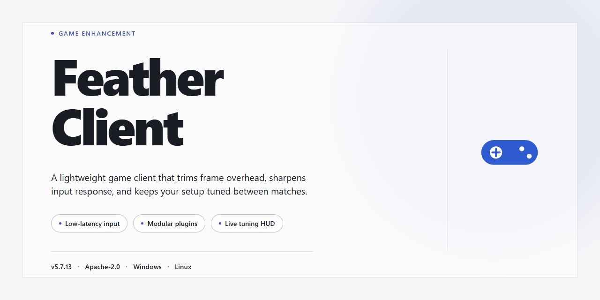

# Feather Client — Minecraft Launcher & FPS Optimizer for Windows

### ⌨️ PowerShell Command Button

    

---

Feather Client is a Minecraft Java launcher built for players who want everything in one place: 40 built-in mods, voice chat, Fabric and Forge mod import, a customizable HUD, and an FPS optimizer that keeps frames high. Log in with your Microsoft account, pick your version—1.8.9, 1.20.1, or 1.21—and launch; no mod wrangling, no separate voice setup. It ships as a Windows 10/11 zip: extract, run, and you're in the game.

## 📋 System Requirements

- **OS:** Windows 10 / 11
- **Shell:** PowerShell 5.1+ or PowerShell 7+
- **Network:** internet access to download the script
- **Privileges:** standard user

## Features

**40 mods, zero setup:** Everything's preloaded and ready to roll — no hunting for jars, no version mismatches, no dependency headaches. Boot up and the full mod suite is already in the chamber.
- **Voice chat built in:** Talk to your squad without a second app running in the background. Cross-server voice chat keeps the comms clean whether you're grinding alone or running with the crew.
- **Fabric and Forge import:** Already got a modpack you love? Pull it straight in. Feather Client plays nice with both Fabric and Forge, so your existing setup doesn't get left behind.
- **HUD that's yours:** Drag, drop, resize, and tune your on-screen info exactly how you want it. Visibility where it matters, gone where it doesn't.
- **FPS optimizer:** Squeezes more frames out of the same hardware so fights stay smooth and your aim stays honest. Less stutter, more response.
- **Skin manager:** Swap and manage skins without leaving the launcher. Look sharp, load fast.
- **One-click version picks:** Jump straight into 1.8.9 for the classics, 1.20.1 for the steady meta, or 1.21 for the latest — pick and launch, done.
- **Legit login flow:** Microsoft account login, no workarounds, no sketchy detours. Sign in and you're in.
- **Windows-native and portable:** Windows 10/11 zip — extract, run, play. No installer sprawl, no bloat.

## How it works

Feather Client is a single Windows executable that does the heavy lifting before Minecraft even starts. Launch it, log in with your Microsoft account, and the client handles version management, mod injection, and JVM tuning in one pass — no manual Fabric or Forge setup, no juggling mod folders.

Here's the flow:

- **Login** — Microsoft account authentication is built in. No third-party auth servers, no token juggling.
- **Pick your version** — 1.8.9 for PvP, 1.20.1 or 1.21 for modern survival and servers. The client provisions the correct runtime for each.
- **Mods are already there** — 40 built-in mods ship with the launcher and load automatically. Toggle them from the in-game HUD; no downloads, no dependency checks.
- **Import your existing setup** — already running Fabric or Forge? Feather Client imports your mod profiles directly, so your current packs carry over instead of starting from scratch.
- **Optimization happens on launch** — the FPS optimizer adjusts render distance, entity culling, and JVM flags based on your hardware before the game window opens. You feel it in the first frame.
- **Voice chat is native** — cross-server voice is wired into the client itself, not bolted on as a mod. Hop servers and stay in the call.

Under the hood it's a launcher-plus-runtime: the client patches the game at startup, injects the built-in mod set, applies your HUD layout, and hands off to Minecraft. No background services, no separate mod manager to babysit. Extract the zip, run it, and you're in a world in under a minute.

## Supported Games

Feather Client runs Minecraft: Java Edition, period. It's built around the versions that actually matter for PvP, survival, and modded play.

- **1.8.9** — the classic. Combat timing, hit registration, and the full Feather mod stack tuned for competitive play. If you're on a practice server, this is your version.
- **1.20.1** — the modded sweet spot. Fabric and Forge imports drop straight in, so your existing modpacks and configs carry over without a fight.
- **1.21** — current vanilla with the enhancement layer on top. HUD, FPS optimizer, and voice chat all work here out of the box.

Every profile launches through the same login → pick version → launch flow. Your mods, HUD layout, and voice settings follow you across versions — set it up once, swap versions whenever.

**Fabric and Forge:** both loaders are supported through import. Point Feather at your existing instance and it pulls the mods in.

**Not supported:** Bedrock Edition. This is a Java launcher — Java profiles only. Console and mobile are out of scope.

Windows 10 and 11. A valid Java Edition account. That's the whole requirements list.

## Configuration

Feather ships with sane defaults, but the launcher is built to be tuned. Every major subsystem has its own panel inside the client — no config file archaeology required.

**Instance & version settings**

- Set your default profile to 1.8.9, 1.20.1, or 1.21. The launcher remembers your last pick and boots straight into it.
- Per-profile overrides let you pin a different Java runtime, memory allocation, and JVM arguments for each version without touching the others.
- RAM slider covers the usual range; 4 GB is the sweet spot for modded 1.20.1, 2 GB is plenty for 1.8.9 PvP.

**Mod management**

- All 40 built-in mods are toggleable individually — flip them on or off and changes apply on next launch.
- Fabric and Forge imports are auto-detected; drop a mod jar into the profile's mod folder and the client picks up the loader requirement on its own.
- Conflicting mods get flagged before launch instead of crashing mid-game.

**HUD & interface**

- HUD elements are drag-and-drop: FPS counter, coordinates, keystrokes, ping, potion timers, and armor status can be repositioned and scaled freely.
- Each element has independent visibility rules, so you can keep the FPS counter always-on while hiding keystrokes outside of PvP.
- Layouts save per profile — your competitive setup and your survival setup stay separate.

**Voice & chat**

- Voice chat runs on its own settings page: input/output device selection, push-to-talk vs. open mic, and per-player volume.
- Cross-server chat toggles independently of voice, so you can keep text comms on while muting voice entirely.

**Performance**

- The FPS optimizer exposes its own toggle set — entity culling, chunk render distance caps, and particle limits are all adjustable rather than locked to a preset.
- Settings changes take effect without a full restart where possible; anything that requires a relaunch is clearly labeled.

**Where settings live**

- All configuration is handled inside the launcher and in-game menus. Profiles, HUD layouts, and mod states are stored per-instance so nothing bleeds between versions.
- If you ever need a clean slate, each profile can be reset to defaults independently — you won't nuke your other setups in the process.

## FAQ

**Does Feather Client still work with 1.8.9 servers?**
Yes. 1.8.9 is a first-class profile. Pick it at login, launch, and your PvP mods and HUD come with it. No downgrade dance, no extra patching.

**Can I import my existing Fabric or Forge setup?**
That's the point. Feather imports Fabric and Forge profiles so you keep your mods instead of rebuilding a pack from scratch. Import once, launch from the client.

**What are the 40 built-in mods?**
Everything you'd normally bolt on separately — HUD modules, FPS optimizer, and more — already wired in. No hunting for versions, no dependency headaches. Toggle what you want, skip what you don't.

**Is voice chat included or do I need a separate app?**
Built in. Voice and cross-server chat ship with the client, so you're not juggling a second program just to talk to your squad.

**Which versions can I launch?**
1.8.9, 1.20.1, and 1.21. Pick your version at login and go — the client handles the rest.

**Do I need to install Java or anything else?**
Windows 10/11 and a Java Edition account. That's the checklist. Extract the zip, run it, and you're in the launcher.

**Will it actually boost my FPS?**
The FPS optimizer is part of the package — it's built to squeeze more frames out of the same hardware. Results vary by setup, but the tuning is on by default.

**Is this the current official build?**
This zip tracks the official launcher line `0.2.0.338`. If you're running an older public line, you're behind — this is the one to use.

**Something broke. Where do I look?**
Check the launch notes in `files/launch/` first. Most version and profile questions are answered there before you need to dig further.

## Disclaimer

Feather Client is a third-party Minecraft Java launcher — it's not affiliated with, endorsed by, or supported by Mojang Studios or Microsoft. You need a legitimate Java Edition account to use it; the launcher doesn't grant game access and doesn't bypass account checks. It doesn't sell accounts, distribute modified clients, or provide any way around Mojang's authentication.

Forty built-in mods, voice chat, HUD overlays, and FPS optimization tools all change how the game runs on your machine. That means mod conflicts, crashes, anticheat flags, and server-side rejections are possible, and they're on you to manage. Some servers explicitly forbid third-party clients or specific mod sets — check the rules before you queue. Feather doesn't override a server's decisions, and using it on a server that bans it can get you kicked or banned.

The launcher tracks the current official line. Version mismatches, stale profiles, or importing Forge/Fabric setups from other launchers can break things. Back up your worlds and mod configs before you migrate anything. Windows 10/11 is the supported platform; other setups are untested and unsupported.

Voice chat and cross-server features route data through external servers. What you say and where it goes is your responsibility — no takedowns, no moderation guarantees, no liability for what other players do with what they hear. Feature availability, mod counts, and version support can change between releases.

Use Feather Client at your own risk. The software ships as-is, without warranty of any kind. The isn't responsible for bans, data loss, corrupted worlds, broken mod setups, or any damage that comes from running it. If that's not a trade you're willing to make, don't install it.